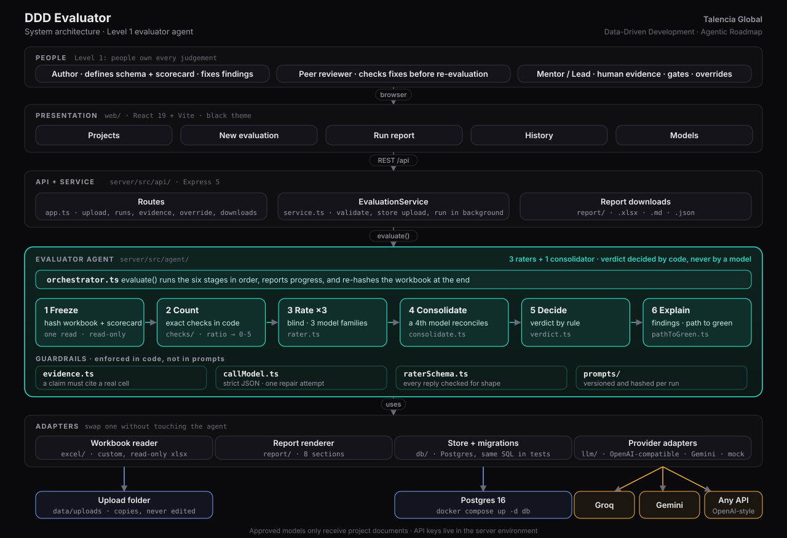

# DDD Evaluator

**The Level 1 evaluator agent** for the Talencia Global *Data-Driven Development · Agentic Roadmap*.

You give it a schema or output workbook and the **frozen scorecard** it is judged against. Three AI raters from three
model families score it blind, a fourth reconciles them, and a rule (never a model) decides **green, amber or red**.
You get the PDF's eight-section report with a path to green. A person fixes the file and submits it again; every
iteration is scored and kept, so you watch the score climb.

> Agents evaluate. People define, produce and approve. The evaluator **never edits** your work, never writes a
> schema or scorecard, and has no auto-fix loop. That is Level 1, as agreed with the mentor.

---

## Where is the agent?

| | |
|---|---|
| **The folder** | [`server/src/agent/`](server/src/agent/): everything that makes up the evaluator agent |
| **The entry point** | [`server/src/agent/orchestrator.ts`](server/src/agent/orchestrator.ts), function `evaluate()` |
| **Its public door** | [`server/src/agent/index.ts`](server/src/agent/index.ts): the rest of the app uses only this |
| **How it works, step by step** | [docs/agent.md](docs/agent.md) |

```
server/src/agent/
├── orchestrator.ts      ★ evaluate(): freeze → count → rate ×3 → consolidate → decide → report
├── rater.ts             runs one rater; keeps only evidence-backed claims
├── consolidate.ts       the 4th model + the code that enforces the PDF's rules on it
├── verdict.ts           green / amber / red, by rule
├── pathToGreen.ts       the smallest set of fixes that would change the verdict
├── findings.ts          findings from code checks, ids, ordering
├── evidence.ts          "does this cited cell really exist?"
├── callModel.ts  raterSchema.ts  types.ts
├── checks/              the nine exact checks done in code
└── prompts/             versioned rater and consolidator prompts
```

## Architecture



More views, all in [docs/architecture.md](docs/architecture.md): system context, one evaluation end to end, the iteration
loop, the data model, deployment. The security view is in [docs/security.md](docs/security.md).

## What it does


1. **Freeze**: read the workbook once, hash it and the scorecard, refuse an unfrozen scorecard or an invalid roster.
2. **Count in code**: everything countable (depth, blanks, duplicates, allowed lists) is scored exactly by code.
3. **Rate**: three blind raters score the judgement dimensions 0-5, each citing the cell it relied on.
4. **Consolidate**: a fourth model reconciles; code enforces the rules (the lower score stands if a disagreement can't be resolved).
5. **Decide**: a function applies the PDF's rule. A HIGH-risk finding blocks green; a critical gate must reach 4.
6. **Report**: eight sections as `.xlsx`, `.md` and `.json`, with a path to green and a full audit trail.

| The report, with the verdict, critical gates and scores | Score trend across iterations |
|---|---|
|  |  |

## Quick start

Needs Node 22+ (`nvm use`).

```bash
npm install
npm run build                      # builds the dashboard
MOCK_LLM=1 npm run start           # http://localhost:4000 with scripted models, no keys, no Docker
npm run seed:demo -w server        # second terminal: three iterations of the sample schema
```

The sidebar says **Mock models (demo)** so a demo is never mistaken for a real evaluation.

**Real run** (Postgres + Groq + Gemini):

```bash
cp .env.example .env               # add GROQ_API_KEY, GEMINI_API_KEY, DATABASE_URL
docker compose up -d db            # Postgres 16 on localhost:5432
npm run models:check -- --ping     # keys valid? models exist? do they answer?
npm run start
```

**Command line, no server or database:**

```bash
npm run evaluate -- --workbook samples/talentra/Talentra-Feature-Discovery-Dashboard.xlsx \
                    --scorecard samples/talentra/talentra-schema-d2.yaml --mock
```

Full setup, configuration and troubleshooting: [docs/operations.md](docs/operations.md).

## Repository structure

```
ddd/
├── README.md  CHANGELOG.md  docker-compose.yml  .env.example  .nvmrc  .editorconfig
│
├── docs/                         documentation (start at docs/README.md)
│   ├── agent.md                    what the agent does, and where its code is
│   ├── architecture.md             how the system fits together
│   ├── scorecard-reference.md      the scorecard format and the nine checks
│   ├── api.md                      REST API reference
│   ├── operations.md               install, configure, run, back up, troubleshoot
│   ├── security.md                 data handling, controls, residual risks
│   ├── pdf-traceability.md         every PDF page mapped to code and tests
│   ├── decisions.md                why it was built this way
│   ├── development.md              working on the code
│   ├── diagrams/                   Mermaid sources + render.sh
│   └── images/                     rendered diagrams and dashboard screenshots
│
├── samples/talentra/             the Talentra workbook and two DRAFT scorecards (need mentor approval)
│
├── scripts/                      checkDocs.mjs: verifies every doc link, anchor, path and folder tree
│
├── shared/src/                   types and scorecard schema shared by server and dashboard
│
├── server/
│   ├── config/                     models.json (live roster) · models.mock.json (demo roster)
│   ├── scripts/                    modelsCheck.ts · seedDemo.ts · patchCells.ts
│   ├── src/
│   │   ├── agent/                  ★ the evaluator agent
│   │   ├── api/                    Express routes and EvaluationService
│   │   ├── db/                     pool, migrations (plain SQL), store
│   │   ├── excel/                  read-only .xlsx reader and the text the raters are sent
│   │   ├── llm/                    Groq / Gemini / OpenAI-compatible adapters, roster rules, mock provider
│   │   ├── report/                 the eight-section report as .xlsx and .md
│   │   ├── scorecard/              scorecard parsing and hashing
│   │   └── util/
│   └── tests/                    128 tests
│
└── web/src/                      the dashboard
    ├── pages/                      Projects · New evaluation · Run · Project history · Models
    ├── components/  styles/  api.ts  hooks.ts  format.ts
```

## Documentation

| | |
|---|---|
| [docs/agent.md](docs/agent.md) | What the agent does, the six stages, guardrails, failure handling, where each part lives |
| [docs/architecture.md](docs/architecture.md) | Context, layers, dependency rules, sequence, data model, deployment |
| [docs/scorecard-reference.md](docs/scorecard-reference.md) | Writing a scorecard: fields, dimensions, checks, bands |
| [docs/api.md](docs/api.md) | Endpoints with examples |
| [docs/operations.md](docs/operations.md) | Setup, configuration, models, database, cost, backup, troubleshooting |
| [docs/security.md](docs/security.md) | Controls, trust boundaries, and the gaps to close before real client data |
| [docs/pdf-traceability.md](docs/pdf-traceability.md) | The Agentic Roadmap PDF, page by page: done, partial, not built |
| [docs/decisions.md](docs/decisions.md) | Fourteen design decisions with reasons |
| [docs/development.md](docs/development.md) | Conventions, tests, recipes, definition of done |

## Technology

TypeScript (strict) on Node 22 · Express 5 · React 19 + Vite + React Router · Postgres 16 (Docker), plain SQL ·
Zod validation at every boundary · Vitest. Models over plain HTTPS: Groq and any OpenAI-compatible API, and Gemini.
No agent framework and no ORM; the reasons are in [docs/decisions.md](docs/decisions.md).

## Quality

```bash
npm run typecheck      # shared, server, web
npm test               # 128 server tests + 3 dashboard tests, all deterministic
npm run docs:check     # every doc link, anchor, path and folder tree is real
```

The tests follow the PDF's rules: every guardrail, every kind of misbehaving model (invalid JSON, no evidence,
outages, out-of-range consolidation), **planted defects in the real Talentra file that must never come out green**,
the provider adapters, the API, and iteration history. The same API tests pass on a real Postgres
(`TEST_DATABASE_URL=...`). Details in [docs/development.md](docs/development.md#testing).

## Status and limits

Read this before relying on a verdict.

- **Not yet run against live Groq or Gemini.** I had no keys; adapters are tested against recorded response shapes.
  Run `npm run models:check -- --ping` first. The default model names in `server/config/models.json` are unverified guesses.
- **The two scorecards are drafts** and say so in every report until your mentor approves them.
- **Prompt size.** The Talentra schema prompt is about 13,400 tokens: fine for Gemini and paid Groq tiers, too big for
  Groq's free tier (such a rater fails early with a clear message). Sectioned evaluation is not built.
- **No authentication, no TLS, no rate limiting.** Put it behind your reverse proxy with sign-in for shared use.
  Full list: [docs/security.md](docs/security.md#residual-risks-read-these).
- **Not built from the PDF:** calibration set and measures, shadow mode, the D1-D4 gate tracker, roles.
  See [docs/pdf-traceability.md](docs/pdf-traceability.md#not-built-yet).

## Roadmap

Levels 2-4 (generator agents, template pipeline, raw thoughts to delivery) are out of scope: the PDF says each level
is earned with evidence from the one below. Next for Level 1: calibration against human scores, sectioned evaluation,
the gate tracker, and authentication. Details in [docs/pdf-traceability.md](docs/pdf-traceability.md#not-built-yet).
