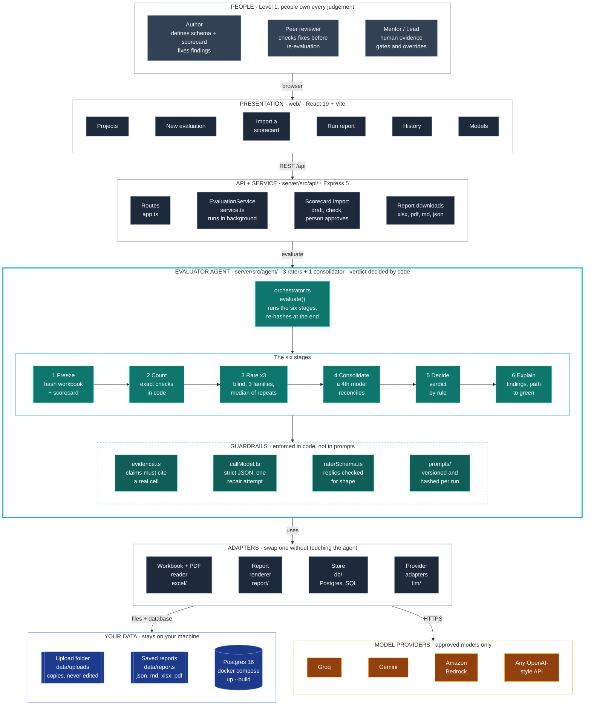

# DDD Evaluator

**The Level 1 evaluator agent** for the Talencia Global *Data-Driven Development · Agentic Roadmap*.

You give it a schema or output workbook and the **frozen scorecard** it is judged against. Three AI raters from three
model families score it blind, a fourth reconciles them, and a rule (never a model) decides **green, amber or red**.
You get the PDF's eight-section report with a path to green. A person fixes the file and submits it again; every
iteration is scored and kept, so you watch the score climb.

> Agents evaluate. People define, produce and approve. The evaluator **never edits** your work, never writes a
> schema or scorecard, and has no auto-fix loop. That is Level 1, as agreed with the mentor.

---

## Where is the agent?

| | |
|---|---|
| **The folder** | [`server/src/agent/`](server/src/agent/): everything that makes up the evaluator agent |
| **The entry point** | [`server/src/agent/orchestrator.ts`](server/src/agent/orchestrator.ts), function `evaluate()` |
| **Its public door** | [`server/src/agent/index.ts`](server/src/agent/index.ts): the rest of the app uses only this |
| **How it works, step by step** | [docs/agent.md](docs/agent.md) |

```
server/src/agent/
├── orchestrator.ts      ★ evaluate(): freeze → count → rate ×3 → consolidate → decide → report
├── rater.ts             runs one rater; keeps only evidence-backed claims
├── consolidate.ts       the 4th model + the code that enforces the PDF's rules on it
├── verdict.ts           green / amber / red, by rule
├── pathToGreen.ts       the smallest set of fixes that would change the verdict
├── repeats.ts           median of an examiner's repeated runs (steadier scores)
├── findings.ts          findings from code checks, ids, ordering
├── evidence.ts          "does this cited cell really exist?"
├── callModel.ts  raterSchema.ts  types.ts
├── checks/              the nine exact checks done in code
└── prompts/             versioned rater and consolidator prompts
```

## Architecture



> The same diagram as a static image (for viewers that do not draw Mermaid): [`docs/images/architecture.svg`](docs/images/architecture.svg).

More views, all in [docs/architecture.md](docs/architecture.md): system context, one evaluation end to end, the iteration
loop, the data model, deployment. The security view is in [docs/security.md](docs/security.md).

## What it does


1. **Freeze**: read the workbook once, hash it and the scorecard, refuse an unfrozen scorecard or an invalid roster.
2. **Count in code**: everything countable (depth, blanks, duplicates, allowed lists) is scored exactly by code.
3. **Rate**: three blind raters score the judgement dimensions 0-5, each citing the cell (or PDF page and line) it relied on. Each can score a section several times and the median is kept; every judged score is labelled steady, shaky or single-examiner.
4. **Consolidate**: a fourth model reconciles; code enforces the rules (the lower score stands if a disagreement can't be resolved).
5. **Decide**: a function applies the PDF's rule. A HIGH-risk finding blocks green; a critical gate must reach 4; a scorecard's `red_at_or_below` line forces red only for a score the examiners agreed on.
6. **Report**: eight sections as `.xlsx`, `.pdf`, `.md` and `.json` (the PDF and the first Excel sheet open with a prioritised "What to improve" list), with a path to green and a full audit trail.

| The report, with the verdict, critical gates and scores | Score trend across iterations |
|---|---|
|  |  |

## Quick start

Needs Node 22+ (`nvm use`).

```bash
npm install
npm run build                      # builds the dashboard
MOCK_LLM=1 npm run start           # http://localhost:4000 with scripted models, no keys, no Docker
npm run seed:demo -w server        # second terminal: three iterations of the sample schema
```

Every finished report is also saved to `data/reports/<project>/iteration-<n>/` (`.json`, `.md`, `.xlsx`, `.pdf`), even on this in-memory database, which forgets its history when the server stops.

The sidebar says **Mock models (demo)** so a demo is never mistaken for a real evaluation.

**One command, everything saved to Postgres** (needs Docker; keys and models come from `.env`):

```bash
docker compose up --build          # http://localhost:4000, data kept in the ddd_pgdata volume
MOCK_LLM=1 docker compose up       # the same, with scripted demo models and no cost
docker compose down                # stop; add -v only to delete the saved data
```

**Real run without Docker for the app** (Postgres + Groq + Gemini):

```bash
cp .env.example .env               # add GROQ_API_KEY, GEMINI_API_KEY, DATABASE_URL
docker compose up -d db            # Postgres 16 on localhost:5432
npm run models:check -- --ping     # keys valid? models exist? do they answer?
npm run start
```

**Command line, no server or database:**

```bash
npm run evaluate -- --workbook samples/talentra/Talentra-Feature-Discovery-Dashboard.xlsx \
                    --scorecard samples/talentra/talentra-schema-d2.xlsx --mock \
                    --instructions "Be strict about definitions."       # optional
```

**The scorecard can be an Excel file or YAML.** Download a ready-to-edit Excel template from the *New evaluation* page, or use
`samples/talentra/talentra-schema-d2.xlsx`. Both formats give the identical scorecard. The page also has a box for **extra
instructions** to the examiners, which are saved with the result. See [docs/scorecard-reference.md](docs/scorecard-reference.md). A scorecard in any other layout can be [imported as a reviewed draft](#importing-a-scorecard-from-another-layout).

Full setup, configuration and troubleshooting: [docs/operations.md](docs/operations.md).

## Repository structure

```
ddd/
├── README.md  CHANGELOG.md  docker-compose.yml  .env.example  .nvmrc  .editorconfig
│
├── docs/                         documentation (start at docs/README.md)
│   ├── agent.md                    what the agent does, and where its code is
│   ├── architecture.md             how the system fits together
│   ├── scorecard-reference.md      the scorecard format and the nine checks
│   ├── api.md                      REST API reference
│   ├── operations.md               install, configure, run, back up, troubleshoot
│   ├── security.md                 data handling, controls, residual risks
│   ├── pdf-traceability.md         every PDF page mapped to code and tests
│   ├── decisions.md                why it was built this way
│   ├── development.md              working on the code
│   ├── diagrams/                   Mermaid sources + render.sh
│   └── images/                     rendered diagrams and dashboard screenshots
│
├── samples/talentra/             the Talentra workbook and DRAFT scorecards (.yaml and .xlsx, including a sectioned one and one for a PDF); all need mentor approval
│
├── scripts/                      checkDocs.mjs: verifies every doc link, anchor, path and folder tree
│
├── shared/src/                   types and scorecard schema shared by server and dashboard
│
├── server/
│   ├── config/                     models.json (live roster) · models.bedrock.json (Amazon Bedrock) · models.mock.json (demo roster)
│   ├── scripts/                    modelsCheck.ts · promptSize.ts · importScorecard.ts · seedDemo.ts · patchCells.ts · scorecardToExcel.ts · importScorecard.ts
│   ├── src/
│   │   ├── agent/                  ★ the evaluator agent
│   │   ├── api/                    Express routes and EvaluationService
│   │   ├── db/                     pool, migrations (plain SQL), store
│   │   ├── excel/                  read-only .xlsx and PDF readers, page ranges, and the text the raters are sent
│   │   ├── llm/                    Groq / Gemini / Bedrock / OpenAI-compatible adapters, roster rules, mock provider
│   │   ├── report/                 the eight-section report as .xlsx, .pdf and .md, plus the "what to improve" list
│   │   ├── scorecard/              scorecard parsing and hashing (YAML, JSON or Excel), and the AI-assisted import (importer.ts, importDraft.ts, importPrompt.ts)
│   │   └── util/
│   └── tests/                    225 tests
│
└── web/src/                      the dashboard
    ├── pages/                      Projects · New evaluation · Import a scorecard · Run · Project history · Models
    ├── components/  styles/  api.ts  hooks.ts  format.ts
```

## Documentation

| | |
|---|---|
| [docs/agent.md](docs/agent.md) | What the agent does, the six stages, guardrails, failure handling, where each part lives |
| [docs/architecture.md](docs/architecture.md) | Context, layers, dependency rules, sequence, data model, deployment |
| [docs/scorecard-reference.md](docs/scorecard-reference.md) | Writing a scorecard: fields, dimensions, checks, bands |
| [docs/api.md](docs/api.md) | Endpoints with examples |
| [docs/operations.md](docs/operations.md) | Setup, configuration, models, database, cost, backup, troubleshooting |
| [docs/security.md](docs/security.md) | Controls, trust boundaries, and the gaps to close before real client data |
| [docs/pdf-traceability.md](docs/pdf-traceability.md) | The Agentic Roadmap PDF, page by page: done, partial, not built |
| [docs/decisions.md](docs/decisions.md) | Fifteen design decisions with reasons |
| [docs/development.md](docs/development.md) | Conventions, tests, recipes, definition of done |

## Technology

TypeScript (strict) on Node 22 · Express 5 · React 19 + Vite + React Router (plain CSS on design tokens, one bundled typeface, Inter) · Postgres 16 (Docker), plain SQL ·
Zod validation at every boundary · Vitest. Models over plain HTTPS: Groq and any OpenAI-compatible API, Gemini and Amazon Bedrock.
No agent framework and no ORM; the reasons are in [docs/decisions.md](docs/decisions.md).

## Quality

```bash
npm run typecheck      # shared, server, web
npm test               # 225 server tests + 3 dashboard tests, all deterministic
npm run docs:check     # every doc link, anchor, path and folder tree is real
```

The tests follow the PDF's rules: every guardrail, every kind of misbehaving model (invalid JSON, no evidence,
outages, out-of-range consolidation), **planted defects in the real Talentra file that must never come out green**,
the provider adapters, the API, and iteration history. The same API tests pass on a real Postgres
(`TEST_DATABASE_URL=...`). Details in [docs/development.md](docs/development.md#testing).

## Evaluating a PDF

The file to check can be an `.xlsx` or a `.pdf`. A PDF is read as text: each page is a sheet (`Page 1`, `Page 2`, ...) and each line a cell in
column A, so evidence is cited as `Page 3!A12`. Because a long PDF is far too big for one prompt, a PDF scorecard gives each question a page
range in `reads` (`reads: ["Page 7-9"]`); see `samples/talentra/talentra-output-schema-pdf.yaml`. Only rater-scored questions apply, since the
counting checks need Excel columns. Scanned PDFs (pictures of pages) have no text and are refused. Check sizes first, with no API calls:
`npm run prompt:size -- file.pdf scorecard.yaml`.

## Using Amazon Bedrock instead of Groq and Gemini

One Bedrock API key can supply all three raters and the consolidator from different model families. Nothing changes for the default setup;
Bedrock is a second roster file you switch on with an environment variable:

```
AWS_BEARER_TOKEN_BEDROCK=your-key
AWS_REGION=us-east-1
MODELS_CONFIG=server/config/models.bedrock.json
```

`models.bedrock.json` also sets `sectionConcurrency: 2` (two sections scored at the same time) and `repeats: 3` (each examiner scores each section three times and the median is kept, which steadies scores but triples the cost; set `repeats` to 1 to spend less). Free tiers keep the defaults of 1 to stay inside their rate limits.

Each model must be enabled for your account in the Bedrock console, in that region (a model can list as offered and still be refused for billing). The model ids in `models.bedrock.json` are starting points:
run `npm run models:check -- --ping` to see which ids your account offers and whether each one answers, then edit the file. Only the
bearer-token (Bedrock API key) sign-in is supported, not AWS access-key signing.

## Importing a scorecard from another layout

The evaluator only scores against a scorecard in its own format, but it can draft one from any other. Open **Import a scorecard** in the sidebar,
add the scorecard (Excel, PDF, YAML, JSON, CSV or text) and, if you have it, the file it will judge. One examiner model drafts the scorecard; code checks it.
You then compare the draft with the original side by side, edit it, tick that you checked it, enter your name and approve it. Only an approved
(frozen) scorecard can be used. Things to know:

- The model only labels each criterion "judged" or "counted"; code does the rest. A dimension with both kinds is split into a judged question and a `-counted` question for a person, and the weight is shared by how many criteria each kind has. A page range longer than the roster can read is cut and the cut is listed. On the mentor's GS-1 file (13 dimensions, 58 criteria) this produced the right 21 questions, weights adding to 100, 7 must-pass gates and the red line, in one 66-second Bedrock call.
- The draft can still misread a rule, so the "Check these first" list and your own comparison matter.
- The same thing from a terminal, with no browser: `npm run scorecard:import -- <scorecard-file> [document.pdf] [--out folder]` writes `draft.yaml` and `notes.json`.
- Criteria that need counting or a person (lists, interviews, sign-offs) become "needs a person"; the agent cannot count them from a document.
- Rules the format cannot hold (caps, averages, formulas) are listed, not applied. A scorecard may set `red_at_or_below` for gate dimensions.
- The import uses the first rater with no prompt-size limit (Gemini in the default roster), so it needs that provider's quota.

## Status and limits

Read this before relying on a verdict.

- **Live models have been tried, with mixed results on free keys.** The smaller Step 04 scorecard ran end to end on live Groq and Gemini and
  produced a real report (twice). One rater was left out each time for a provider reason (Gemini overload, then a Gemini quota, then a Groq
  size refusal), which is exactly what fallback models and graceful degradation are for. The large schema scorecard (D2) ran live once in its **sectioned** form and produced a partial result: see below. Model availability varies by account and over time, so re-run the ping on your own keys.
- **The two scorecards are drafts** and say so in every report until your mentor approves them.
- **Prompt size, and it blocked the first live run.** The Talentra schema prompt is about **18,000 to 21,500 tokens per rater** (Groq measured
  18,336 and 21,482). Groq's free tier allowed 8,000 and 7,000 per minute, so the Groq raters were refused. The app now measures the prompt
  at submit and says so before running (it needs at least two raters that can take it); that measurement is an estimate and can be off by half
  for number-heavy content.
- **Sectioned scoring (built, tried live once).** A rater question can list the sheets and columns it needs (`reads`), so the prompt is split into
  smaller sections. On the Talentra D2 schema, estimated tokens per rater fell from **20,500 in one prompt to 8,000 in the largest section (-61%)**,
  but the total sent to each rater rose to about 28,700 (+40%), because instructions and shared columns repeat. The consolidator is now sent only
  the sheets behind real disagreements: **4,890 tokens, where it used to be sent the whole judged workbook (about 16,000)**.
  The one live run (3 min 56 s, free keys) gave **AMBER 84.8** where the same scorecard could not run at all before. It was partial: Gemini's
  free quota ran out and its fallback answered; Groq's `gpt-oss-120b` and `qwen3.8-27b` were refused on most sections (limits 8,000 and 7,000;
  Groq counted one request at 12,499 tokens against an estimate of about 7,700). So J01 to J04 were scored by two examiners, J05 by one, and J06 was
  left unscored because its only claim had no valid evidence. The agent said so in the report instead of guessing. A full 3+1 result on the big schema still needs
  higher-limit keys. Try your own files without spending quota: `npm run prompt:size -- <workbook> <scorecard>`.
- **Scorecard import is new and not measured.** It has run live four times on the mentor's GS-1 file and each draft needed fixes (code now enforces weights, page limits and the frozen flag, but a person must still check every draft).
- **Bedrock works on one account, in one small run.** `models.bedrock.json` (GLM 5, Llama 3.3 70B, Mistral Large, Nova Pro) answered every ping, and the Step 04 scorecard ran end to end on it in 46 seconds with all three raters and the consolidator succeeding (RED 72.8). Claude was refused on that account (a billing subscription was missing). The large schema and a full PDF have not been run on it.
- **A PDF is read in small slices.** Each question reads at most three pages, so a long PDF is a sampled review, not a full audit.
- **Scores vary between runs.** The same PDF gave RED 66.2 once and AMBER 80.3 once. Repeats (median of several runs) and the steady/shaky label reduce and show this, but nothing here is calibrated against human scores yet.
- **Free tiers are fragile.** Gemini's newer models have small quotas and busy periods; Groq's free limits are about 7,000 to 8,000 tokens a minute.
  Fallback models (same family) soften this; a paid or higher-limit key removes it.
- **No authentication, no TLS, no rate limiting.** Put it behind your reverse proxy with sign-in for shared use.
  Full list: [docs/security.md](docs/security.md#residual-risks-read-these).
- **Not built from the PDF:** calibration set and measures, shadow mode, the D1-D4 gate tracker, roles.
  See [docs/pdf-traceability.md](docs/pdf-traceability.md#not-built-yet).

## Roadmap

Levels 2-4 (generator agents, template pipeline, raw thoughts to delivery) are out of scope: the PDF says each level
is earned with evidence from the one below. Next for Level 1: calibration against human scores (including the accuracy of scorecard import), covering more of a long PDF per question,
the gate tracker, and authentication. Details in [docs/pdf-traceability.md](docs/pdf-traceability.md#not-built-yet).
