# The evaluator agent

> **Where is the agent?** In one folder: [`server/src/agent/`](../server/src/agent/).
> The entry point is [`orchestrator.ts`](../server/src/agent/orchestrator.ts), function `evaluate()`.
> The rest of the application reaches it only through [`agent/index.ts`](../server/src/agent/index.ts).

This page explains what the agent does, step by step, and which file does each part. It is the Level 1
agent from the *Talencia Global · Data-Driven Development · Agentic Roadmap* (pages 9-14). For the whole
system around it, see [architecture.md](architecture.md).

---

## 1. What the agent is, and is not

**It is** an evaluator. You give it a workbook (a schema, or an output document) and the frozen scorecard that
says how to judge it. It scores every dimension of the scorecard, decides **green, amber or red**, and explains
the result: where each problem is, how to fix it, and the smallest set of fixes that would turn it green.

**It is not** an author. At Level 1 the agent:

- never edits the workbook (it is opened read-only and hashed before and after),
- never writes or changes a schema or scorecard,
- never fixes anything and re-scores in a loop (a person fixes; the evaluator runs again),
- never decides a verdict with a model (a function applies the rule).

It is "an agent" in the sense the PDF uses: a system of four model calls plus code that checks them. It is
deliberately **not** a free-roaming agent loop. The flow is fixed, so every step can be enforced and tested.

## 2. The folder

```
server/src/agent/
├── index.ts            public API: evaluate(), buildVerdictSection(), buildPathToGreen(), PROMPT_VERSION
├── orchestrator.ts     ★ evaluate(): runs the six stages in order       (start reading here)
│
├── checks/             stage 2: exact checks done in code
│   ├── library.ts        the nine built-in checks
│   ├── index.ts          runs a scorecard's code dimensions, ratio → 0-5 by bands
│   └── types.ts
│
├── prompts/            versioned prompts (PROMPT_VERSION)
│   ├── rater.ts          what each rater is told
│   └── consolidator.ts   what the consolidator is told
│
├── rater.ts            stage 3: runs one rater, keeps only evidence-backed claims
├── fallback.ts           backup models: same participant, same family, tried in order
├── prompt.ts             builds what the raters are sent (shared with the pre-submit check)
├── preflight.ts          before running: can enough raters take this prompt?
├── callModel.ts          one model call + the single "repair" retry on a bad reply
├── raterSchema.ts        the exact shape a model reply must have
├── evidence.ts           "does this cited cell really exist, and does the quote appear in it?"
│
├── consolidate.ts      stage 4: reconcile three raters; code enforces the PDF rules
│
├── verdict.ts          stage 5: weighted score, critical gates, green / amber / red
├── findings.ts         stage 6: findings from code checks, ids, ordering
├── pathToGreen.ts      stage 6: smallest set of fixes that changes the verdict
└── types.ts            internal types (rater outcomes, draft findings, call metadata)
```

What the agent **uses** but does not own: `llm/` (talks to Groq, Gemini and other providers), `excel/` (reads
workbooks), `util/` (hashing, small helpers). What it **never** imports: `api/`, `db/`, `report/`. That boundary
is checked in [architecture.md](architecture.md#dependency-rules).

## 3. Inputs and outputs

| | |
|---|---|
| **In** | The workbook file path · the parsed, frozen **scorecard** (from an Excel, YAML or JSON file, and its hash) · optional **source documents** and optional **extra instructions** (text) · the model **roster** (3 raters + 1 consolidator) · a run id, project name and iteration number |
| **Out** | `EvaluationOutput`: the immutable **core** (header, per-dimension results, findings, strengths, notes), one record per model call (prompt, raw reply, what was discarded), and a **run log** (models, hashes, timings, tokens) |
| **Side effects** | None on the workbook. Progress events are sent to a callback so the dashboard can show live status. The agent itself does not touch the database. |

The verdict, "not measurable" list and path to green are **derived** from the core (plus any human evidence and
override) whenever a report is read, by `report/assemble.ts`. The core never changes after the run.

## 4. The six stages



### Stage 1 · Freeze  (`orchestrator.ts`)

Fixes the inputs so the target cannot move (PDF p.13).

1. Refuses a scorecard that does not say `frozen: true`.
2. Checks the roster: three raters from **three different model families**, every model on the **approved**
   list, every provider has a key (`llm/roster.ts`).
3. Reads the workbook **once**, takes its SHA-256, and parses it from those bytes.
4. Checks that every sheet the scorecard names exists, and builds the set of sheets a rater may cite.
5. At the very end it reads the file again. If the hash differs the run is aborted and nothing is reported.

### Stage 2 · Count in code  (`checks/`)

Dimensions marked `measured_by: code` are not given to a model. A built-in check counts them exactly:
"how many of these rows are right?", for example *"168 of 169 nodes have a definition"*. The pass ratio is turned
into a 0-5 score by the dimension's `bands`. Nine checks exist (see the
[scorecard reference](scorecard-reference.md#built-in-checks)): `max_value`, `column_filled`, `unique`,
`any_filled`, `list_refs_resolve`, `lists_referenced`, `values_in_list`, `value_not_in`, `row_count_at_least`.

Why code and not the raters: a model counting cells is slower, costs money, and can be wrong; code is exact,
free and repeatable. This is the one place the build goes beyond the PDF's wording (see
[decisions.md](decisions.md#adr-3-code-scores-the-countable-dimensions)).

A check that cannot run (missing column, unknown check id) never crashes the run: that dimension becomes
**unscored**, counts as 0, and a HIGH finding explains why.

### Stage 3 · Rate  (`rater.ts`, `callModel.ts`, `evidence.ts`, `prompts/rater.ts`)

The three raters run **in parallel**, each in its own call, and each is sent exactly the same prompt:

- the frozen scorecard (only the dimensions measured by raters, with their 0-5 anchors),
- the artifact: every non-empty cell written with its address, e.g. `H5="Which product..."`,
- the context sheets and the source documents,
- the **extra instructions** the person typed when submitting (if any): the same words go to every rater and to the consolidator, and are saved in the report header with a hash,
- the rules: *score each dimension 0-5 using only the anchors, cite the cell, never invent, reply with JSON only*. The rules also say the extra instructions may steer what to look at but can **never** change the anchors, the 0-5 scale, the evidence rule or the JSON format, and cannot say what score to give.

Nothing else is in the prompt: no other rater's score, no author self-assessment, and no code-check results
("blind rating", PDF p.13). The scorecard's `columns` option trims what raters see so the prompt stays small.

What comes back is checked, not trusted:

| Check | If it fails |
|---|---|
| Reply is not valid JSON, or has no `dimensions` list | One repair attempt, telling the model what was wrong. Still bad: that rater is **left out** and the report says so. |
| A score is not an integer from 0 to 5 | That score is **discarded** |
| A score cites no cell, or a cell that does not exist, or a quote that is not in the cell (`evidence.ts`) | That score is **discarded** ("no evidence, no score") |
| A finding names an unknown dimension or has no valid location | That finding is **discarded** |
| The rater says `not_measurable` | Treated as an abstention, not a score |

Everything discarded is counted and stored per rater, so nothing disappears silently. If a model's context
limit is known (`maxInputTokens` in `models.json`) and the prompt is bigger, that rater fails immediately with
advice instead of sending a doomed request.

If a rater's model fails, its configured **fallback models** are tried in order. A fallback answers as the same participant and counts as the same
family, so independence is kept (`agent/fallback.ts`); the report header names the model that really answered and the run notes say what
failed first. The consolidator has fallbacks too.

If **all three** raters fail the run fails loudly. A report built on nothing would show a misleading red.

### Stage 4 · Consolidate  (`consolidate.ts`, `prompts/consolidator.ts`)

A fourth model reads the three validated results plus the artifact and proposes, per dimension, one score and a
set of merged findings. It does **not** rate from scratch. Then **code enforces the PDF's rules** on whatever it
said (PDF p.10):

| Situation | Result |
|---|---|
| No rater gave a valid score; all declined | Dimension is **not measurable**: a person must supply it |
| No rater gave a valid score; some failed or were discarded | **Unscored**: counts as 0, flagged for a person |
| Only one rater gave a valid score | That score, flagged for a person |
| Raters differ by **1 point or less** | The consolidator's score if it lies between the lowest and highest rater score, otherwise the lowest |
| Raters differ by **more than 1** and the consolidator resolved it **with cited evidence** | Its score, but only if it lies between the lowest and highest rater score (choosing the lowest needs no evidence) |
| Raters differ by more than 1 and it could not resolve it, or cited nothing real | **The lower score stands**, flagged for a person |

So the consolidator can never invent a score outside what the raters said, and a big disagreement can only be
overruled with evidence that really exists in the file. Duplicate findings are merged, the highest severity of any
member wins (merging can never soften a finding), and any finding the consolidator did not merge is kept rather than dropped.

If the consolidator itself fails, the run continues: wherever raters differed the lower score is used and flagged,
and every rater finding is kept. The report notes it.

### Stage 5 · Decide  (`verdict.ts`)

A plain function, never a model (PDF p.12).

```
weighted score = sum(weight × score) × 100 / (5 × sum of weights counted)
```

Counted: every code and rater dimension (an unscored one counts as 0, so a missing score can never help), plus a
human-only dimension once a person has given it a score. A human note without a score unblocks green but adds no points.



A critical gate means a `critical: true` dimension scoring **4 or more**. A **HIGH-risk finding blocks green** until
it is fixed (PDF p.11), even when the score is high; MEDIUM and LOW findings do not. The score is compared
unrounded and displayed rounded **down**, so 89.96 is never shown as 90. A person may override the result up or
down but must give a written reason; the agent's own verdict stays on record next to it.

### Stage 6 · Explain  (`findings.ts`, `pathToGreen.ts`)

- **Findings**: every code check that is not perfect becomes a finding pointing at the failing cells, with a fix
  taken from the scorecard. Rater findings are added after consolidation. Each gets an id (`F-01`...), a severity
  (**HIGH blocks green**, MEDIUM fix in this pass or record why it is deferred, LOW improve when convenient), the
  stage to return to, and who raised it.
- **Path to green**: plain arithmetic. First lift every critical gate that is below 4, then raise the dimensions
  that add the most weighted score until the accept threshold is reached. It reports each step (`4 → 5, +2.6`),
  lists the HIGH findings that must be fixed before resubmission, and says plainly when a person must still supply
  human-only evidence.

Finally the report is assembled from the core (`report/assemble.ts`): the PDF's eight sections as `.xlsx`,
`.md` and `.json`.

## 5. Guardrails

Every guardrail on PDF page 13 is enforced by code, and has a test.

| Guardrail | Where it is enforced | Test |
|---|---|---|
| Independence: different model families | `llm/roster.ts` refuses the roster | `orchestrator.test.ts` › Independence |
| Freeze: fixed and hashed before rating | `orchestrator.ts` hashes first, re-hashes last | › Freeze (aborts if the file changes mid-run) |
| Blind rating | one shared prompt, built without scores or other raters | › keeps raters blind |
| Evidence: unsupported claims discarded | `evidence.ts`, `rater.ts` | `evidence.test.ts`, › discards scores that cite no evidence |
| Lower score stands | `consolidate.ts` | › keeps the lower score… / › refuses a consolidator score outside the range |
| Read-only | the reader only reads; hash compared after | › never touches the workbook |
| Reproducible | prompts, hashes, models, tokens, discards stored | `api.test.ts` run log |
| Confidentiality | `llm/roster.ts` approved list | › Confidentiality |

## 6. When things go wrong

| What happens | What the agent does |
|---|---|
| A rater returns invalid JSON | One repair attempt, then that rater is left out; the report says so |
| A rater's provider is down, rate-limited or out of quota | The HTTP layer retries with back-off (honouring `Retry-After`); then the rater's **fallback models** are tried in order (same family); only if all fail is that rater left out |
| Two raters fail | The one left is used and every dimension it scored is flagged for a person |
| All three raters fail | The run **fails** with the reasons; no verdict is invented |
| The consolidator fails | Lower score used wherever raters differ; flagged; findings kept unmerged |
| A code check cannot run | That dimension is unscored (0) with a HIGH finding |
| The workbook changes during the run | The run fails; nothing is reported |
| The scorecard is not frozen, or names a missing sheet or column | Refused up front with a message saying exactly what to fix |
| The prompt is bigger than a model's limit | That rater fails immediately, with advice to use `columns` |

## 7. What is recorded

For every run, in Postgres ([data model](architecture.md#data-model)): the frozen scorecard, both hashes, every
model call (the exact prompt, the raw reply, how many claims were discarded and why, tokens, latency), each
dimension's score from each rater, every finding, any human evidence, and any override. Given that, any result can
be explained and any run repeated.

## 8. Extending it

| To... | Do this |
|---|---|
| Add a built-in check | Add it to `agent/checks/library.ts` and the `CHECKS` map, describe its params with zod, add a test in `checks.test.ts`, and list it in [scorecard-reference.md](scorecard-reference.md) |
| Add a model provider | Anything OpenAI-compatible needs only an entry under `providers` in `server/config/models.json`. A different API shape needs an adapter in `llm/` implementing `LlmProvider` and a case in `llm/registry.ts` |
| Change what the raters are told | Edit `agent/prompts/*.ts` **and bump `PROMPT_VERSION`**, so old runs stay explainable. Re-check calibration |
| Change the verdict rule | `agent/verdict.ts` plus its test table in `verdict.test.ts`. Remember the PDF fixes the rule; change it only on the mentor's decision |
| Add a scorecard | Write a YAML file in the [scorecard format](scorecard-reference.md); no code change |

## 9. Glossary

| Term | Meaning |
|---|---|
| **D1, D2, D3, D4** | Schema design, its scorecard, the output document, its scorecard. This agent judges D1 against D2 and D3 against D4 |
| **Dimension** | One thing a scorecard measures, with a weight, and a measurer (code, raters or a person) |
| **Critical gate** | A critical dimension; it needs 4 or more or the verdict cannot be green |
| **Anchors** | The text that says what a 0, 1 ... 5 means for one dimension |
| **Bands** | For code dimensions: which pass ratio maps to which 0-5 score |
| **Spread** | Highest minus lowest rater score for a dimension |
| **Human-only** | Evidence only a person can supply (for example the author interview) |
| **Iteration** | One submission of a project; each is scored and kept |
