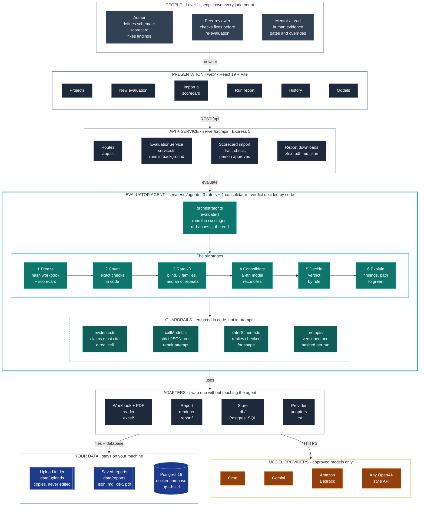
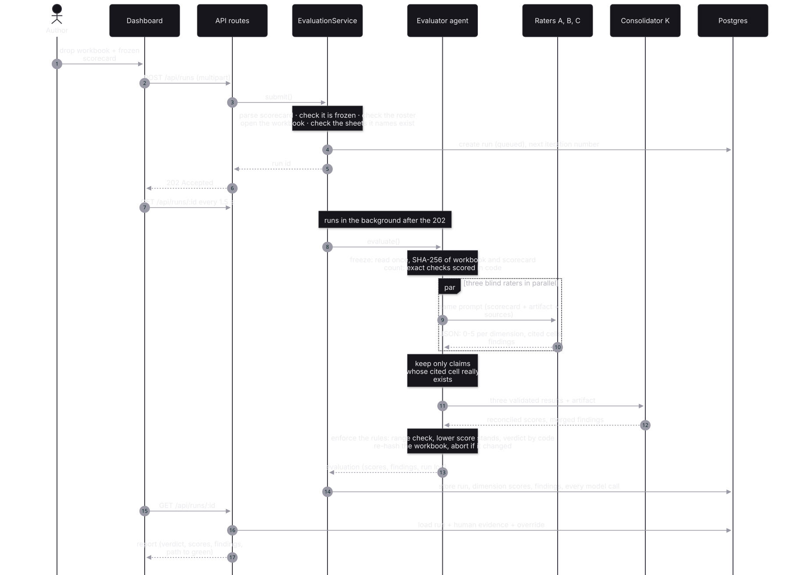

# Architecture

This page describes how the DDD Evaluator is put together: the parts, how they talk, where the data lives,
and how it is meant to be deployed. For what the evaluator agent itself does, see [agent.md](agent.md).

## Contents

1. [Goals and constraints](#goals-and-constraints)
2. [System context](#system-context)
3. [Layers](#layers)
4. [Dependency rules](#dependency-rules)
5. [One evaluation, end to end](#one-evaluation-end-to-end)
6. [The iteration loop](#the-iteration-loop)
7. [Data model](#data-model)
8. [Runtime model](#runtime-model)
9. [Deployment](#deployment)
10. [Failure modes](#failure-modes)
11. [Observability](#observability)
12. [Technology](#technology)

## Goals and constraints

The system exists to carry out **Level 1** of the Agentic Roadmap: evaluator agents score every deliverable
against its scorecard, and people keep the judgement. That fixes the shape of the design.

| Goal | What it means for the design |
|---|---|
| Trustworthy scores | Everything that can be counted is counted in code; models only judge what needs judging, and every claim they make is checked against the file |
| Auditable | Every input, prompt, raw reply, score and decision is stored; any result can be explained |
| Independent | The evaluator never edits the work it judges and never shares a session with the author; raters come from different model families |
| People decide | The agent recommends. Human evidence and overrides are first-class, stored beside the agent's own verdict |
| Honest under failure | Degrade visibly (flag, leave out, fail loudly), never silently |
| Small and replaceable parts | Providers, storage and report formats sit behind thin adapters |

Out of scope by design: generating schemas or scorecards, auto-fixing, template pipelines (Levels 2-4).

## System context



Three kinds of people use it. The **author** submits work and fixes findings. The **peer reviewer** checks fixes
before a re-evaluation. The **mentor or lead** supplies human-only evidence (for example the author interview),
approves gates and may override a verdict. All three use the dashboard.

## Layers



> The same diagram as a static image (for viewers that do not draw Mermaid): [`images/architecture.svg`](images/architecture.svg).

| Layer | Folder | Responsibility |
|---|---|---|
| Presentation | `web/` | React dashboard: projects, new evaluation, live run, report, history, models. Talks only to `/api` |
| API + service | `server/src/api/` | HTTP routes, request validation, uploads; `EvaluationService` validates a submission, stores it and runs the evaluation in the background |
| **Evaluator agent** | `server/src/agent/` | The six-stage evaluation, the guardrails and the decision rule. No knowledge of HTTP, databases or report formats |
| Adapters | `excel/`, `llm/`, `report/`, `db/` | One job each: read a workbook, call a model provider, render a report, persist data |
| Shared contract | `shared/` | Types and the scorecard schema used by both server and dashboard |

## Dependency rules

Dependencies point **inwards** towards the agent, and the agent depends on very little:

```
web  ──►  /api  ──►  api/  ──►  agent/  ──►  llm/ · excel/ · util/
                      │            ▲
                      ├──►  db/ ───┘ (types only)
                      └──►  report/ ──►  agent/ (verdict, path to green)
```

- `agent/` imports only `llm/`, `excel/`, `util/` and a config type. It never imports `api/`, `db/` or `report/`.
- `llm/`, `excel/` and `scorecard/` never import `agent/`.
- Everything outside `agent/` reaches it through its single door, [`agent/index.ts`](../server/src/agent/index.ts).

These were checked against the actual imports when this was written. Because the agent knows nothing about
Express or Postgres, it can be run from the command line (`npm run evaluate`) and tested without a server.

## One evaluation, end to end



Points worth knowing:

- The `POST /api/runs` call **returns at once** with `202 Accepted`. The evaluation continues in the background and
  the dashboard polls `GET /api/runs/:id` every 1.5 seconds, showing which stage is running and which model has answered.
- All submission mistakes (unfrozen scorecard, unknown sheet, roster not ready, wrong file type) are caught **before**
  anything is stored or any model is called, and come back as a plain-language error.
- The three raters run in parallel; the consolidator runs after them.
- The report you read is **assembled on read** from the stored, immutable evaluation plus any human evidence
  and override. Adding evidence or an override never changes the agent's own scores.

## The iteration loop



This is PDF page 12. The agent produces the verdict and the path to green; **a person** fixes the file and
resubmits. Each submission becomes a new iteration of the same project, scored independently. Resubmitting
under an existing project name adds an iteration to it, so the score trend, the fixed / still-open / new findings
and the per-dimension heatmap build up automatically.

A finding's identity across iterations (`fingerprint`) is the dimension for code findings (the failing cell moves
as rows get fixed) and dimension + cell for rater findings.

## Data model



| Table | Holds |
|---|---|
| `projects` | A schema being iterated; name is unique |
| `runs` | One evaluation: status and stage, both hashes, a frozen copy of the scorecard, the immutable `core` (the evaluation), the `run_log`, the score and the agent / final decision |
| `model_calls` | Every model call: provider, model, family, exact prompt, raw reply, discarded claims, tokens, latency |
| `dimension_scores` | Each dimension's score, spread, rater scores and flag, queryable for trends |
| `findings` | Each finding with its location, fix and fingerprint |
| `human_evidence` | What a person supplied for a human-only dimension (optional score, note, who) |
| `overrides` | A person's override of a verdict, with the required reason |

Migrations are plain SQL in `server/src/db/migrations/`, applied once each in name order, on server start or with
`npm run db:migrate`. There is no ORM. The same SQL runs on real Postgres and on the in-memory Postgres (`pg-mem`)
used for tests and the no-Docker demo.

## Runtime model

- **One Node process** serves the API and, in production, the built dashboard.
- **Evaluations run in-process**, in the background of the request that started them. There is no separate queue
  or worker. This keeps the system small; the cost is that a crash loses in-flight work. On the next start,
  any run left "queued" or "running" is marked **failed** with an explanatory message, so nothing hangs forever.
- **Concurrency**: several evaluations can run at once. Provider rate limits are handled by the HTTP layer
  (retry with back-off, honouring `Retry-After`).
- **State**: the database holds all state. The only files are the uploaded workbooks (`data/uploads/`), kept as
  read-only copies so a run can be re-examined.

## Deployment



| Mode | How |
|---|---|
| Demo | `MOCK_LLM=1 npm run start`: scripted models, in-memory database, no keys, no Docker |
| Local, real | `docker compose up -d db`, keys in `.env`, `npm run start` |
| Shared / production | The same, on a VM, behind a reverse proxy that provides TLS and sign-in. **The app has no login of its own** (see [security.md](security.md)) |

`docker-compose.yml` starts **Postgres only**. The application is not containerised yet.

Scaling notes: a single process is sufficient for a team. To go beyond it, the natural step is to move
`EvaluationService.execute` onto a job queue and run several workers; the agent needs no change, because it is
a pure function of its inputs apart from the model calls.

## Failure modes

How each failure is handled is tabulated in [agent.md](agent.md#6-when-things-go-wrong). At system level:

| Failure | Effect | Recovery |
|---|---|---|
| Database down | API returns 500; nothing is lost that was stored | Restart the database; the app reconnects per request |
| Server crash mid-run | That run is marked failed on next start | Submit again |
| Provider outage or rate limit | Retries, then that rater is left out (or the run fails if all are down) | Fix the provider or change the roster |
| Disk full / uploads folder missing | Submission fails with a server error | Free space or set `DATA_DIR` |

## Observability

- The server logs one line per notable event to the console, prefixed `[ddd]`: start-up, migrations, roster
  problems, interrupted runs, unhandled errors. API keys are never logged.
- `GET /api/health` returns `{ ok: true, db: "postgres" | "memory" }` for liveness checks.
- Per-run observability is in the data: the `run_log` (timings, tokens, attempts per model) and `model_calls`.
- There are no metrics endpoint or tracing yet.

## Technology

| Concern | Choice | Why (details in [decisions.md](decisions.md)) |
|---|---|---|
| Language | TypeScript (strict), Node 22, ES modules | One language across agent, API and dashboard |
| API | Express 5 | Small, well known, async errors handled |
| Dashboard | React 19, React Router 7, Vite | Plain CSS with design tokens; no UI framework |
| Database | Postgres 16 (Docker), `pg` driver, plain SQL | Durable and inspectable; same SQL runs in-memory for tests |
| Models | Plain HTTPS to each provider; no agent framework | The flow is fixed; every rule must be enforceable and testable |
| Validation | Zod at every boundary (scorecard, requests, model replies) | Untrusted input is checked once, at the edge |
| Excel | Custom read-only reader (input), ExcelJS (report output) | The common library cannot open the Talentra file |
| Tests | Vitest; scripted mock models | Deterministic, fast, and able to simulate misbehaving models |
