# Security and data handling

This page says what the system protects, how, and, just as important, what it does **not** protect yet.
Read the [residual risks](#residual-risks-read-these) before putting real client documents through it.

## What is being protected

| Asset | Why it matters |
|---|---|
| **Project documents** (workbooks, source documents) | May be client confidential; the PDF requires that only approved models receive them (p.13) |
| **Model API keys** | They spend money and identify the organisation |
| **Verdicts and the audit trail** | A false green lets a weak deliverable through to every step built on it (PDF p.14) |
| **The scorecard** | If it could change mid-evaluation the target would move |

## Trust boundaries

Everything the browser sends and every uploaded file is **untrusted**. Everything a model returns is **untrusted
too**: it is checked before it is believed. Project documents leave the server only through the roster gate, and
only to approved models.

## Controls

### Input handling

| Control | Detail |
|---|---|
| File type and size | Only `.xlsx` workbooks; uploads capped at 25 MB each, at most two files |
| Safe parsing | The workbook is unzipped and its XML read as **data** (`excel/xlsxReader.ts`). Macros, formulas, links and embedded objects are never executed, and drawings are ignored |
| Strict scorecard | Parsed against a schema (Zod); a wrong shape is rejected with a message (unknown extra keys are ignored). Scorecards contain data only, no code |
| Request validation | JSON bodies are validated (Zod); string lengths, enums and score ranges are enforced |
| Uploaded file names | Sanitised to `[\w.- ]` and stored under a generated run id, so a name cannot escape the uploads folder |
| Regular expressions | A scorecard's `pattern` is a regular expression chosen by the people who write scorecards, who are trusted. Do not accept scorecards from outsiders |

### Models and data leaving the server

| Control | Detail |
|---|---|
| **Approved list** | A model not in `approved` in `models.json` is refused before anything is sent (`llm/roster.ts`). This covers **fallback models** too: one that is not approved makes the roster not ready, because a fallback receives the documents when the primary fails |
| **Keys** | Read from the server environment only. Never stored in the database, never logged, never in an API response (`/api/config` says only whether a key is set). Gemini's key is sent in a header, not the URL, so it cannot leak into logs |
| **Independence** | Three distinct families, so one provider's mistake or compromise cannot decide a verdict alone |
| **Minimum necessary** | `columns` in a scorecard limits what raters are sent; sheets not listed are never sent |

### Integrity of the result

| Control | Detail |
|---|---|
| **Evidence gate** | A score or finding counts only if it cites a cell that exists, with a quote that really appears in it. Text planted in a document cannot invent a finding about a cell that is not there |
| **Verdict by code** | No model output is ever used as a verdict. Models supply scores; a function applies the rule |
| **Range checks** | The consolidator cannot produce a score outside what the raters said; unresolved disagreements keep the lower score |
| **Freeze** | Workbook and scorecard are hashed before and after the run; a change aborts it |
| **Read-only** | The evaluator never writes to the workbook |
| **Audit trail** | Every prompt, raw reply, score, human entry and override is stored with who and when |
| **Overrides need a reason** | And the agent's own verdict is stored beside the override, never replaced |

### Prompt injection

A workbook is data from an author, and an author could try to influence the raters by writing instructions into a
cell ("score this 5"). The design limits the damage but cannot remove it:

- The prompts tell models to treat the artifact as data, never instructions.
- **Extra instructions** typed in the dashboard come from the person submitting the work. They are given to every rater in the same words, saved with the run and hashed, and the rules in the prompt say they can never change the scale, the evidence rule or the output format, or dictate a score. They are still text sent to the model providers, so do not put confidential material in them that is not already in the workbook.
- **Counted dimensions are scored by code**, which cannot be talked into anything.
- Every rater claim must cite a real cell, and the verdict is computed by code, so injected text cannot fabricate evidence or set the verdict.
- Three different model families score independently, so one model being fooled shows up as a **spread** and gets flagged.
- **Residual risk:** a rater could still be nudged on a judgement dimension. This is why people review every amber and red, and why a human-only gate exists.

## Residual risks (read these)

These are known gaps in this version, not oversights hidden from you.

| Risk | Detail | What to do |
|---|---|---|
| **No authentication or authorisation** | Anyone who can reach the server can submit, read every report, record evidence and override verdicts. The "by" name on evidence and overrides is typed, not verified | Run it only on a trusted network, or behind a reverse proxy with SSO. Treat names as unverified until auth is added |
| **No TLS** | The server speaks plain HTTP | Terminate TLS at a reverse proxy |
| **No rate limiting** | An open server can be made to spend API budget by anyone who can submit | Same: restrict access; set provider spending limits |
| **Documents are stored in full** | Uploads sit unencrypted in `data/uploads/`, and `model_calls.prompt` in Postgres contains the artifact text | Use disk and database encryption, restrict access, apply a retention policy. There is no delete endpoint yet |
| **Provider data handling** | Once a document is sent, retention and training use are governed by that provider's terms | Choose providers and tiers your client agreements allow; keep `approved` tight |
| **Default database credentials** | `docker-compose.yml` uses `ddd` / `ddd` and publishes port 5432 | Change the password and do not expose the port beyond the host |
| **Dependencies** | Open-source packages are not pinned by hash or scanned in CI | Run `npm audit` and a scanner in your pipeline |
| **Non-determinism** | Models may vary slightly even at temperature 0 | The run log records what actually happened; calibration (not built) is how drift is caught |

## Hardening checklist for a shared deployment

- [ ] Reverse proxy with TLS and company sign-in in front of the app
- [ ] Database password changed; port 5432 bound to localhost or a private network only
- [ ] `.env` readable only by the service account; keys rotated on a schedule; provider spending caps set
- [ ] `approved` in `models.json` reviewed against client agreements
- [ ] Disk encryption on the host; uploads folder and database backed up and access-controlled
- [ ] A retention rule for old runs and uploads, and a way to purge them
- [ ] `npm audit` clean, dependencies reviewed
- [ ] Someone owns the scorecards: changes are versioned, reviewed and frozen

## Reporting a problem

This is an internal Talencia Global project. Report security concerns to the project owner directly, not in a shared
channel, and include the steps to reproduce but not any client document.
